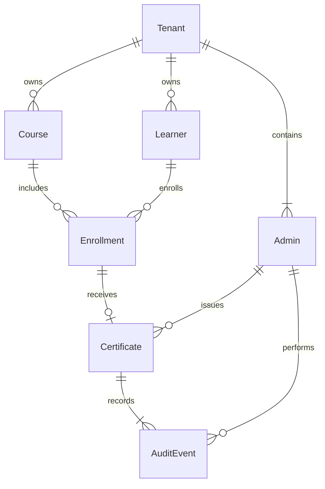

# Data model

Tenant owns Admin, Course and Learner. Enrollment joins a learner and course within one tenant. Each enrollment can have one permanent Certificate. Each certificate has one ISSUED audit event and, after revocation, one REVOKED audit event.

## Identity and tenant boundaries

IDs are UUIDs. Admins and learners are separate identities, each belonging to one tenant. Learner email is unique within a tenant. Each learner/course pair has one enrollment; repeated attempts are outside this scope. Composite foreign keys include tenantId for enrollments, certificate actors, and audit actors, preventing cross-tenant references. ActorGuard resolves an opaque bearer token to an admin; only its hash is persisted, directly on Admin. Tokens are demo credentials with no login or expiration flow.

Tenant creation and its first admin must share one transaction. A deferred constraint verifies at least one admin at commit. Admin membership changes lock the tenant row so concurrent removals cannot remove every admin. Admin tenant identity cannot change. Normal database permissions should restrict migration/DDL privileges; an owner capable of disabling triggers can bypass database invariants.

## Enrollment and certificate lifecycle

Enrollment stores INCOMPLETE with no completedAt, or COMPLETED with a completedAt timestamp. Display status is incomplete/completed, overridden to certified while its certificate is active. Revocation returns the display status to completed, retaining the revoked certificate separately. `enrollmentDisplayStatus` implements this projection.

CertificatesService locks the tenant-scoped enrollment before issuance. Only COMPLETED is eligible. The unique enrollment reference allows at most one certificate for that learner/course forever. Concurrent or repeated issuance returns the same certificate, including after revocation, without new audit events. Issuance fields and certificate identity are immutable. Each certificate also has a globally unique immutable serial number: `CERT-` followed by 32 uppercase hexadecimal characters generated by the database from a random UUID. The additive serial migration backfills existing active and revoked certificates without changing audit history. Certificates cannot be deleted. An enrollment with a certificate must remain completed.

Revocation locks the tenant-scoped certificate. It requires an actor, timestamp and nonblank reason (up to 1000 characters). It is final; subsequent revocations return the existing result. Reissuance is unsupported. Services accept an authenticated Actor; future transports must obtain it from ActorGuard rather than client-provided IDs.

The database independently checks eligibility and tenant relationships. Certificate transition triggers create audit events atomically with issuance/revocation; a failed audit insert rolls back the certificate operation. Audit rows are immutable, cannot be inserted directly, and have a unique certificate/action pair. Truncation of certificate/audit history is rejected. A successful issuance therefore has exactly one ISSUED event, and a successful revocation exactly one REVOKED event, with matching actor/timestamp. Migration triggers are essential behavior beyond Prisma's schema representation.

## Tenant-local issue date

Tenant.timeZone is a PostgreSQL-recognized time zone; seed values are IANA identifiers. At issuance, the service records issuedAt as a UTC instant, issueDate as a PostgreSQL DATE derived in the tenant's zone, and issueTimeZone as the zone snapshot. Application database sessions use UTC for Prisma timestamp encoding; this does not change the tenant-local date calculation. The database verifies the date independently. Changing the tenant zone never changes historical dates. Revocation/audit timestamps are instants, not dates. The application and PostgreSQL timezone databases should be kept current and aligned.

## Verification and limits

Database tests use a unique temporary schema on an explicitly selected isolated test database. They apply the real migration and exercise concurrent requests, database bypass attempts, tenant foreign keys, completion checks, final revocation, immutable audit history, tokens and repeatable seeds. Unit tests cover dates across UTC midnight and DST transitions. Health and browser smoke tests remain database-independent.

HTTP endpoints expose health, the authenticated actor, and a tenant-scoped read-only certificate list with learner-name/serial search, sorting, and pagination. Authenticated course options and course-based bulk issuance are available. Bulk issuance snapshots course enrollments and processes each independently, using the same tenant-scoped lock and issuance transaction. It returns issued, skipped (incomplete, already issued, or revoked), and failed outcomes; concurrent/repeated requests create at most one certificate and one issuance audit event per enrollment. CSV exports use durable PostgreSQL jobs and chunked artifacts, scoped to the tenant and requesting admin. Revocation endpoints and administrative CRUD remain future scopes. The browser list accepts a generated admin token in memory without a login page. No automatic business-data cache is introduced. Migration rollout and seed execution are explicit actions; the running development database is not changed by implementation verification.

## Export jobs

CertificateExport references its requester through `(tenantId, requestedById)` to enforce tenant ownership. A partial unique index allows at most one queued/running job per admin. Captured search/sort fields are validated by the API and constrained in the database. Job progress satisfies `0 <= processed <= total`. CertificateExportChunk stores ordered CSV bytes and cascades only when its export is removed; no certificate or audit relation is deleted by export cleanup.

Workers claim jobs under a transaction-scoped advisory lock. A lease UUID fences every progress/chunk write and final status update, so a worker that lost ownership cannot publish stale output. Each fresh/retried attempt uses a new repeatable-read data snapshot. Artifacts expire 24 hours after completion; queued/interrupted metadata also has a bounded initial 24-hour lifetime. Cleanup removes expired jobs and their chunks, never certificate history. A generation timeout/failure removes partial output; interrupted processes leave leases that another worker can reclaim. See README's certificate export section for endpoint contracts, limits, and performance verification.
